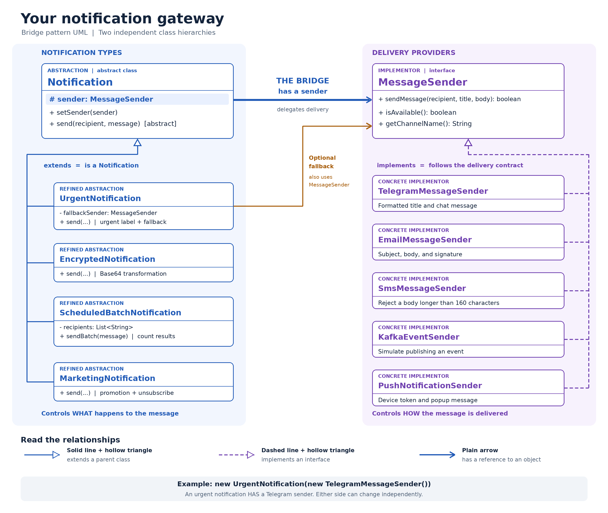

# Multi-Channel Notification Gateway

Java 17 application demonstrating the Bridge pattern for SDP Assignment 3. Notification behavior and message delivery are separate hierarchies, connected through the `MessageSender` interface. All providers are simulated; no external accounts, services, or API credentials are needed.

## Requirements

- JDK 17 or newer
- Maven
- JUnit Jupiter 5.11.4 for tests
- Maven Compiler Plugin 3.13.0 and Maven Surefire Plugin 3.5.2, configured in `pom.xml`

## Run the application

1. Open the project folder containing `pom.xml` in IntelliJ IDEA.
2. Load or reload the Maven project.
3. Select JDK 17 or newer for the project and Maven runner.
4. Open `Main.java` and run its `main()` method.

The application prints simulated deliveries, fallback attempts, and batch summaries to the console.

## Run the tests

From the project root:

```bash
mvn test
```

Alternatively, run `NotificationGatewayTest` in IntelliJ IDEA.

The supplied test class contains 12 JUnit 5 tests covering successful Email delivery, unavailable Email, the SMS length boundary, Base64 transformation, successful urgent delivery without fallback, fallback after primary unavailability, batch successes and failures, batch counter resets, runtime provider switching, Push delivery, and Marketing message preparation.


## Pattern roles

| Bridge role | Classes |
| --- | --- |
| Abstraction | `Notification` |
| Refined Abstraction | `UrgentNotification`, `EncryptedNotification`, `ScheduledBatchNotification`, `MarketingNotification` |
| Implementor | `MessageSender` |
| Concrete Implementor | `TelegramMessageSender`, `EmailMessageSender`, `SmsMessageSender`, `KafkaEventSender`, `PushNotificationSender` |
| Bridge relationship | `Notification` holds a `MessageSender` reference and delegates delivery to it |

## UML class diagram



## Notification behavior

| Notification | Responsibility |
| --- | --- |
| Urgent | Prefix the message with `[URGENT]`, check availability, and try an optional fallback if the primary is unavailable or rejects delivery |
| Encrypted | Base64-encode the UTF-8 message before sending |
| Scheduled Batch | Store recipients, attempt delivery to each, and report total, successful, and failed deliveries |
| Marketing | Add a `[PROMO]` prefix, use the title `Special offer`, and append an unsubscribe instruction |

Base64 is reversible encoding, not secure encryption.

## Provider behavior

| Provider | Simulated behavior |
| --- | --- |
| Telegram | Print a chat recipient, formatted title markers, and body |
| Email | Print recipient, subject, body, and signature |
| SMS | Send only the body and reject a body longer than 160 Java string characters |
| Kafka | Print an event for the `notifications` topic, using the recipient as its key |
| Push | Print a device token, popup title, and popup message |


## Mandatory demo scenarios

| Scenario | Demonstration |
| --- | --- |
| Urgent + Telegram | An available Telegram sender delivers an urgent message |
| Encrypted + Email | Email receives the Base64-encoded body |
| Scheduled Batch + SMS | SMS delivers to the stored recipients and the batch prints a summary |
| Runtime switching | The same urgent notification changes from Telegram to Email through `setSender()` |
| Fallback | Telegram is made unavailable and SMS delivers the urgent message |
| Marketing + Push | Push receives the prepared promotional message |
| Encrypted + Push | Push receives the Base64-encoded body |

